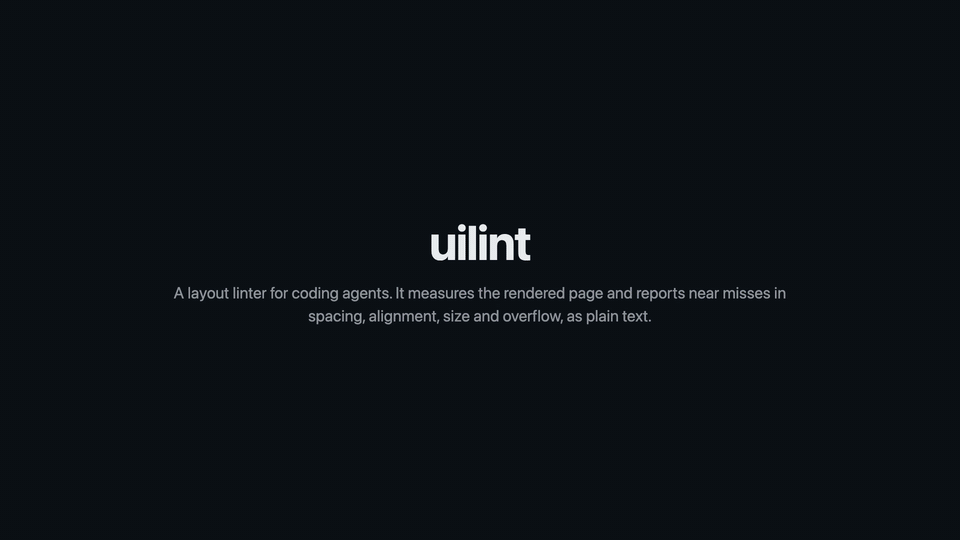
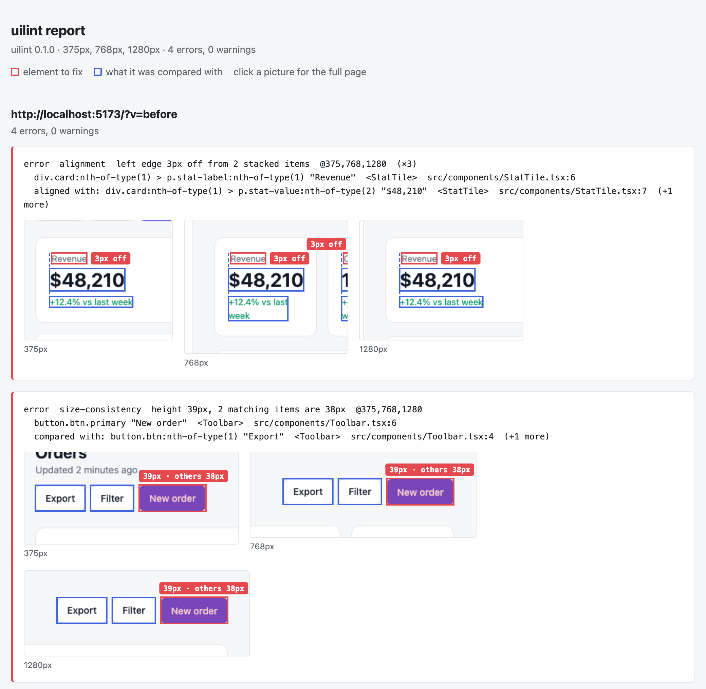
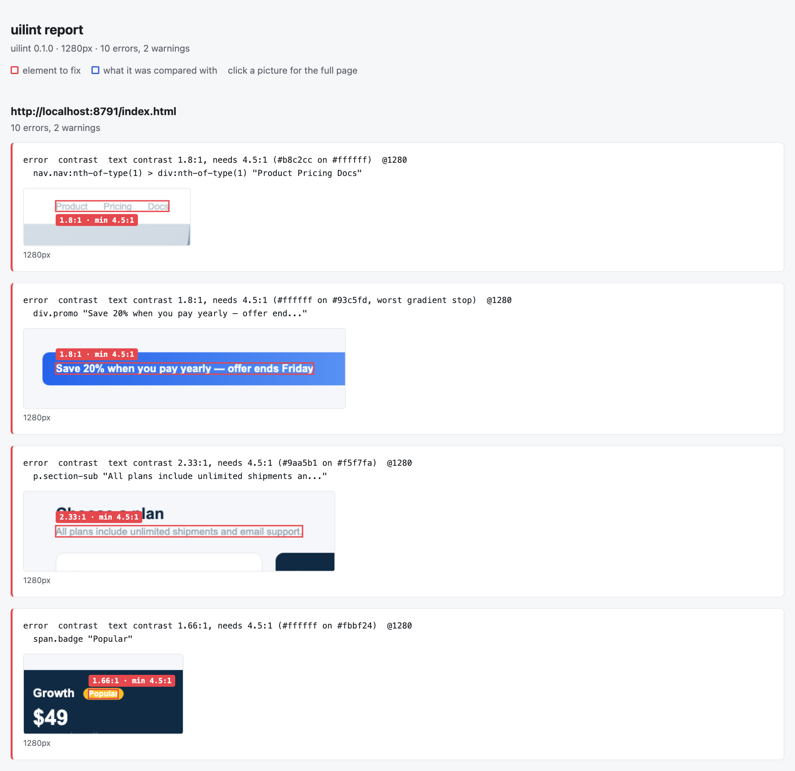

# uilint

[](LICENSE)
[](package.json)
[](https://playwright.dev)

A layout linter for coding agents. It measures the rendered page and reports near-miss spacing, alignment, size and overflow problems, and text too low in contrast to read, as plain text, with an exit code the agent can act on.

[](docs/media/uilint-demo.mp4)

In the demo above (56s, [full-quality mp4](docs/media/uilint-demo.mp4)), an agent runs uilint on a React dashboard it built. uilint reports a label 3px out of line with the numbers under it, a 20px gap among 16px gaps on a phone, a button 1px taller than its neighbors, and a page that scrolls 58px sideways at 375px. The agent fixes each one at the JSX line uilint named, reruns, and gets exit code 0. Everything in the video is real uilint output; [`demo/`](demo/) regenerates it. To check the same findings yourself, `--report` draws each one on a screenshot of the page ([visual report](#visual-report)).

uilint loads a web page in a real browser, measures where every visible element landed, and reports small layout mistakes as text: spacing that is slightly off, edges a few pixels out of line, near-identical elements with slightly different sizes, and clipped or overflowing content. It also checks that text is readable against what is actually painted behind it. It is meant to be run by a coding agent after it changes UI, so the agent gets a deterministic list of problems to fix instead of guessing from screenshots.

uilint only flags near misses. Two edges 3px apart are almost certainly a mistake, while two edges 40px apart are almost certainly intended, so uilint reports the first and ignores the second. The same goes for a 14px gap among 16px gaps (reported) and a 64px gap above a hero (ignored). This keeps false alarms low without anyone annotating the page.

## Install and run

uilint needs Node 20 or newer. To try it once against a page that's running locally:

```sh
npx playwright install chromium
npx @aselhid/uilint http://localhost:3000/dashboard
```

To keep it in a project:

```sh
npm i -D @aselhid/uilint
npx uilint http://localhost:3000/dashboard
```

The package is published as `@aselhid/uilint` because the npm name `uilint` belongs to an unrelated project. The command it installs is still `uilint`. Don't run a bare `npx uilint` in a project that doesn't have it installed, because npx would fetch that other package.

## Reading the output

```
uilint  http://localhost:3000/dashboard   2 errors, 1 warning

error  alignment  left edge 3px off from 2 stacked items  @375,768,1280
  p.stat-label "Revenue"  <StatTile>  src/components/StatTile.tsx:12
  aligned with: h3.card-title "Customers"  <CardHeader>  src/components/CardHeader.tsx:7  (+1 more)

error  spacing  gap 14px, siblings use 16px  @1280  (×3)
  li.order-row "Order 1003"  <OrderRow>  src/orders/OrderRow.tsx:8
  li.order-row "Order 1004"  <OrderRow>  src/orders/OrderRow.tsx:8
  compared with: li.order-row "Order 1001"  <OrderRow>  src/orders/OrderRow.tsx:8  (+2 more)

warn   overflow  text truncated with ellipsis  @375
  span.email "jane.long-name@example.com"  <CustomerRow>  src/customers/CustomerRow.tsx:21
```

Each block is one problem. The first line gives the severity, the rule, what was measured against what was expected, and the viewport widths where it happens. `(×3)` means the same problem repeats on 3 similar elements, such as list rows. The indented lines point at the elements to fix: a CSS selector, a snippet of visible text, the nearest React component, and the JSX line that created the element (the line to edit). A spacing problem names the two boxes on either side of the gap. `aligned with:` or `compared with:` names the elements that set the expected value. Component names and source files need a React development build; without one, a line shows only the selector and text.

Exit codes:

| code | meaning |
|---|---|
| 0 | no errors (warnings are allowed) |
| 1 | one or more errors |
| 2 | uilint itself failed: the page didn't load, returned HTTP 400 or above, a setup script threw, the config is invalid, or the layout never stopped moving |

## Visual report

The text output is written for the agent. For the person reviewing the agent's work, `--report` also writes one self-contained HTML file that shows each problem on a screenshot of the page:

```sh
npx uilint http://localhost:3000/dashboard --report uilint-report.html
```

[](docs/media/uilint-report.png)

Each card repeats the finding exactly as the terminal prints it, then shows the affected part of the page at every width where it happens. The element to fix is outlined in red, the elements that set the expected value in blue, and the measurement is drawn where it was taken: a shaded gap labelled `20px · siblings 16px`, a dashed edge line labelled `3px off`, a `+58px` strip for a page that scrolls sideways, and a label such as `2.32:1 · min 4.5:1` beside text that is too low in contrast (the text itself isn't shaded, so its colours show as they are). Click a picture to see the whole page.

The screenshots are taken right after uilint measures, in the same browser session, so the outlines sit on the pixels uilint measured. A few things to know:

- The report lists every finding, including ones `--max` hides from the text output. Baselined and ignored findings are left out of both.
- Screenshots cover the first 10,000px of the page. A finding further down is drawn on a wireframe of the measured boxes.
- An adapter without screenshot support gets the wireframe for every finding.
- The file makes no network requests, so it can be attached to a PR or kept as a CI artifact. Each screenshot is embedded once, so the size grows with pages × widths, not with the number of findings.
- `--report` doesn't change the text output, the JSON or the exit code, apart from a `report written to …` note.

## Command line

```
uilint [urls...]
  --config <path>        config file (default: ./uilint.config.ts, then ./uilint.config.json)
  --viewport <widths>    override configured widths, comma separated, e.g. 375,1280
  --driver <name|path>   browser adapter: playwright (default), betterwright, or a module path
  --profile <dir>        playwright: launch with an existing user-data dir to reuse a login
  --cdp <port|url>       playwright: attach to an already-running Chrome
  --setup <file>         script run before measuring (open a modal, fill a form, ...)
  --json                 machine-readable output
  --max <n>              cap the number of reported violations (default 50)
  --update-baseline      write current violations to the baseline file and exit 0
  --report <file>        also write a visual HTML report to <file> (see Visual report)
```

With no URLs, uilint lints the `pages` listed in the config. `--setup` applies to every URL on the command line; use `pages` in the config when each page needs its own setup.

## What it checks

Rules compare only boxes you can see: text, images and icons, form controls, and elements with a background, border, outline or shadow. A plain wrapper `<div>` is invisible, so it is skipped, which is why alignment works across different parts of the HTML tree. Boxes are compared with others in the same visible container and the same layer, so a modal is never compared with the page behind it. uilint treats an element as its own layer when it is `position: fixed`, an open `<dialog>`, an open popover, `aria-modal="true"`, or has role `dialog`, `alertdialog`, `menu`, `listbox` or `tooltip`. A dropdown that is only `position: absolute` with none of these shares the page's layer; give it the right role, which screen readers need anyway. While a modal `<dialog>` is open (`showModal()`), the page behind it is inert, so uilint measures only the modal; lint the page in a state without the modal. Content under an `inert` attribute is skipped too.

Inline boxes in running text, such as inline `<code>` or a highlighted link inside a paragraph, are not lined up, spaced or sized against other boxes: where they land depends on where the line wraps. They are still checked for contrast and overlap. Text is compared for overlap run by run, so a paragraph never overlaps the inline code inside it.

| rule | check | what it reports |
|---|---|---|
| `alignment` | `left`, `right`, `center-x` | a box nearly in line with a column that at least two other boxes share exactly |
| `alignment` | `top`, `bottom`, `center-y`, `baseline` | an item nearly in line with its neighbor in a row |
| `spacing` | `gap` | one gap that nearly matches the gaps around it in a stack or row; gaps above and below headings are compared only with other heading gaps |
| `spacing` | `inset-x`, `inset-y` | a container whose padding nearly matches on opposite sides |
| `spacing` | `min-gap`, `scale` | optional limits, off by default |
| `size-consistency` | `height`, `width` | a button, card or input nearly the same size as its siblings |
| `overflow` | `clipped` | text cut off by an `overflow: hidden` ancestor (a scroll container, such as a code block with `overflow-x: auto`, doesn't count on the axis it scrolls) |
| `overflow` | `ellipsis` | text truncated with an ellipsis (a warning by default) |
| `overflow` | `spill` | a box sticking out of its container (text and controls are errors, decoration such as a badge dot is a warning; an image cropped by an `overflow: hidden` ancestor counts only as far as it shows) |
| `overflow` | `hscroll` | the page scrolls sideways |
| `overflow` | `overlap` | text or controls overlapping each other |
| `contrast` | `ratio` | text, or the value typed in a form field, below the WCAG 2.x contrast minimum: 4.5:1, or 3:1 for large text (24px, or 18.66px bold) |
| `contrast` | `placeholder` | a form field's placeholder below the same minimum |
| `contrast` | `unverified` | text whose background uilint can't know, such as an image or video (a warning by default) |

uilint only flags near misses for layout. Contrast is different: WCAG sets a hard minimum, so any text below it is reported, with the colours it measured:

```
error  contrast  text contrast 2.32:1, needs 4.5:1 (#aaaaaa on #ffffff)  @375,768,1280
  p.meta "Updated 3 days ago"  <OrderRow>  src/orders/OrderRow.tsx:14
```

[](docs/media/uilint-contrast-report.png)

The picture is the top of the `--report` for [`demo/contrast/`](demo/contrast/), a pricing page with low-contrast text planted in it. The full run finds 10 errors, among them white text on the light end of a gradient, a white badge on amber and a pale input placeholder, plus 2 warnings for hero text over a background image.

How the contrast rule finds the background: at the middle of each run of text, it asks the browser which elements are painted under that point, in paint order, and blends their background colours from the text down until it reaches an opaque one. Transparency and `opacity` are blended the way the browser blends them, and an absolutely positioned backdrop behind a heading counts as the heading's background. A gradient is checked against its worst colour stop. When something under the text has colours CSS can't tell, such as an image, video, canvas, `backdrop-filter`, blend mode or `filter`, uilint doesn't guess: it reports a `contrast/unverified` warning that names the reason. Text in disabled controls (`:disabled`, `aria-disabled="true"`) is skipped. Form fields are checked for the value they show, or their placeholder when they're empty. To see under the first screen, uilint scrolls the page while it checks contrast and scrolls back afterwards, after any `--report` screenshot is taken. With `contrast: 'off'` this check doesn't run at all. One known gap: a `::before` or `::after` layer painted over a background isn't seen, because the browser doesn't report pseudo-elements at a point, so text on such a layer is measured against the background under it.

Every rule runs at each viewport width (375, 768 and 1280 by default). Before measuring, uilint waits for the network to go quiet and for fonts to load, disables animations and transitions, and measures repeatedly until two measurements in a row match.

## Configuration

uilint reads `uilint.config.ts`, or `uilint.config.json`, from the folder you run it in; `--config` points it elsewhere. Every key is optional. In the example, `pages`, `rules`, `exclude` and the driver's `profile` are illustrations (the first three default to empty, which means every rule at `error` with default options); every other value shown is the default.

```ts
import { defineConfig } from '@aselhid/uilint';

export default defineConfig({
  viewports: [375, 768, 1280],      // widths to lint at
  viewportHeight: 900,
  pages: [
    { url: 'http://localhost:3000/' },
    { url: 'http://localhost:3000/settings', setup: './uilint/open-settings.ts' },
  ],
  rules: {
    alignment: 'error',             // 'off' | 'warn' | 'error'
    spacing: ['error', { max: 3 }], // severity plus options
    overflow: ['error', { ellipsis: 'off' }],
  },
  exclude: ['.intercom-launcher'],  // selectors whose subtrees are skipped
  ignoreFile: 'uilint.ignore',
  baselineFile: 'uilint.baseline.json',
  driver: { name: 'playwright', options: { profile: './.uilint-profile' } },
  timeouts: { navigation: 30000, stable: 10000 },
});
```

Paths in the config are resolved from the config file's folder.

Each rule takes options, listed below with their defaults. `min` and `max` set the near-miss window in px: a difference counts when it is above `min` and at most `max`. `maxRatio` also caps it at a share of the expected value.

| rule | options (defaults) |
|---|---|
| `alignment` | `min: 0.5`, `max: 4`, `maxGap: 48`, `minColumnPeers: 2`, `minRowPeers: 1` |
| `spacing` | `min: 0.5`, `max: 4`, `maxRatio: 0.25`, `maxGap: 96`, `maxInset: 64`, `minTextGap` (unset), `scale` (unset) |
| `size-consistency` | `min: 0.5`, `max: 4`, `maxRatio: 0.25`, `maxGap: 48` |
| `overflow` | `tolerance: 1`, `clipped: 'error'`, `ellipsis: 'warn'`, `spill: 'error'`, `spillDecorative: 'warn'`, `hscroll: 'error'`, `overlap: 'error'` |
| `contrast` | `level: 'AA'`, `ratio: 'error'`, `placeholder: 'error'`, `unverified: 'warn'` |

For `contrast`, `level: 'AAA'` raises the minimums to 7:1, and 4.5:1 for large text.

`maxGap` is how far apart two boxes can be and still count as neighbors. `minColumnPeers` is how many boxes must already share an edge before a box nearly on it is reported; two unrelated boxes often land a few pixels apart by chance. Set `scale: 4` under `spacing` if your design uses a 4px grid and you want every gap checked against it.

## Accepted exceptions: `uilint.ignore`

The owner of the project lists deviations they accept, one per line:

```
# rule or check | matcher | viewport | reason
spill     | component:Avatar      | *   | the notification dot sits on the corner on purpose
alignment | text:Revenue          | 375 | stacks differently on mobile, checked by design
*         | selector:.legacy-nav  | *   | old navigation, replaced next quarter
```

The first field is a rule name, a check name from the table above, or `*`. The matcher is `component:Name`, `text:substring` or `selector:css` (an exact match on the selector uilint prints). The viewport is a width or `*`. The reason is required. When you lint the configured `pages` with no URL arguments, uilint lists entries that matched nothing, so the file doesn't collect stale lines.

uilint never reads exceptions from the page's own markup. There is no `data-` attribute or class that hides a violation, so an agent can't silence one by editing the UI code.

## Baseline for an existing app

The first run on an existing app will find old problems. Record them so only new ones fail:

```sh
npx uilint --update-baseline
```

This writes `uilint.baseline.json`, a list of fingerprints. Later runs show baselined violations as a count in the header and fail only on new ones. A fingerprint comes from the rule, the page path and the elements involved, not from pixel values, so it survives unrelated changes. After fixing old problems, run `--update-baseline` again on a clean run to shrink the file; running it while new errors exist would accept those too.

## Logged-in pages and pages behind a click

For a mocked dev server, pass the URL.

For a real session, log in once in a browser profile uilint can reuse:

- `--profile <dir>` launches Chromium with that user-data folder. Use a dedicated folder, not Chrome's default profile: Chrome blocks automation on its default profile, and a profile is locked while another browser has it open.
- `--cdp <port>` attaches to a Chrome you started with `--remote-debugging-port=<port>` and already logged into. uilint opens its own tabs and closes only those.

For a modal, an open menu or a filled form, write a setup script. It runs after the page loads and before measuring:

```ts
// uilint/open-delete-modal.ts
import type { Page } from 'playwright';

export default async (page: Page) => {
  await page.click('text=Delete project');
  await page.waitForSelector('[role=dialog]');
};
```

```sh
npx uilint http://localhost:3000/projects/1 --setup uilint/open-delete-modal.ts
```

## Browser adapters

uilint talks to the browser through a small adapter, so you can use the browser tooling you already have. The rules, report, ignore file and baseline are the same for every adapter.

### playwright (default)

Options: `profile`, `cdp`, `channel` (for example `chrome` to use installed Chrome), `headless` (default `true`). A setup file is a module whose default export receives the Playwright `Page`.

### betterwright

[BetterWright](https://github.com/BetterWright/betterwright) gives agents a persistent, policy-guarded browser. Install it yourself (`npm i -D betterwright`); it also needs Bun 1.4 or newer for its browser worker.

```sh
npx uilint http://localhost:3000/ --driver betterwright
```

Options: `home`, `profile` (a BetterWright identity name, not a folder), `headless`, `stealthRuntimeFix`, `timeout` (ms per step). BetterWright keeps its own persistent profile, so logins carry over between runs; `--profile` and `--cdp` do not apply. A setup file is a BetterWright snippet with `page` in scope:

```js
// uilint/open-delete-modal.bw.js
await page.click('text=Delete project');
await page.waitForSelector('[role=dialog]');
```

With `stealthRuntimeFix` on, page scripts run in an isolated world and can't read React's internals, so violations come without component names or source files. The report says so.

### Your own adapter

Pass a module path (or an installed package name) to `--driver`. The module exports `createDriver(options)`, which returns a `Driver`:

```ts
interface Driver {
  name: string;
  open(url: string, viewport: { width: number; height: number }, timeoutMs: number): Promise<DriverPage>;
  close(): Promise<void>;                       // idempotent
}

interface DriverPage {
  status: number | null;                        // HTTP status of the main document
  capabilities: { mainWorld: boolean };          // false if page scripts can't see page globals
  url(): Promise<string>;                       // URL after redirects
  evaluate<T>(expression: string): Promise<T>;  // evaluate a JS expression string, await it, return JSON
  addStyle(css: string): Promise<void>;
  waitForNetworkIdle(timeoutMs: number): Promise<void>; // never throws on timeout
  runSetup(file: string): Promise<void>;
  screenshot?(opts: { maxHeight: number }): Promise<Buffer>; // optional, for --report: full-page PNG from (0,0)
                                                // at CSS scale, document width, at most maxHeight tall
  close(): Promise<void>;                       // idempotent
}
```

A Puppeteer adapter, for example:

```js
// puppeteer-driver.mjs
import puppeteer from 'puppeteer';
import { pathToFileURL } from 'node:url';

export async function createDriver(options) {
  const browser = await puppeteer.launch({ headless: options.headless ?? true });
  return {
    name: 'puppeteer',
    async open(url, viewport, timeoutMs) {
      const page = await browser.newPage();
      await page.setViewport({ ...viewport, deviceScaleFactor: 1 });
      const response = await page.goto(url, { waitUntil: 'load', timeout: timeoutMs });
      let closed = false;
      return {
        status: response ? response.status() : null,
        capabilities: { mainWorld: true },
        url: async () => page.url(),
        evaluate: (expression) => page.evaluate(expression),
        addStyle: async (css) => { await page.addStyleTag({ content: css }); },
        waitForNetworkIdle: (ms) => page.waitForNetworkIdle({ timeout: ms }).catch(() => {}),
        runSetup: async (file) => { await (await import(pathToFileURL(file).href)).default(page); },
        screenshot: async ({ maxHeight }) => {
          const [width, height] = await page.evaluate('[document.documentElement.scrollWidth, document.documentElement.scrollHeight]');
          return Buffer.from(await page.screenshot({ clip: { x: 0, y: 0, width, height: Math.min(height, maxHeight) }, captureBeyondViewport: true }));
        },
        close: async () => { if (!closed) { closed = true; await page.close(); } },
      };
    },
    close: () => browser.close(),
  };
}
```

```sh
npx uilint http://localhost:3000/ --driver ./puppeteer-driver.mjs
```

To check an adapter, run uilint's conformance tests against it with vitest. The setup file must set `document.title` to `setup-ran`, in your adapter's setup format:

```ts
// puppeteer-driver.test.ts
import { runDriverConformance } from '@aselhid/uilint/conformance';
import { createDriver } from './puppeteer-driver.mjs';

runDriverConformance('puppeteer', () => createDriver({}), { setupFile: '/abs/path/to/setup-title.mjs' });
```

## Using it with a coding agent

`agent/INSTRUCTIONS.md` is a short block to paste into your agent's instructions (CLAUDE.md, AGENTS.md or similar). `agent/skills/uilint/SKILL.md` is the same content as a Claude Code skill; copy the `uilint` folder into `.claude/skills/`.

The instructions have the agent pass `--report uilint-report.html` on every run, so a visual report of the last run is waiting for you when the agent finishes; the agent names the file in its summary but doesn't read it. Add `uilint-report.html` to your `.gitignore`.

Keep `uilint.ignore`, `uilint.baseline.json` and the config under your own review, for example with CODEOWNERS. Nothing technically stops an agent from editing them; the instructions tell it not to.

## Developing uilint

```sh
npm install
npx playwright install chromium
npm test
npm run build
```

`tests/fixtures/bad/` holds pages with one planted defect each, and `tests/fixtures/clean/` holds well-built pages that must produce zero errors. The clean pages are the main guard against false alarms. To add screens from your own app, save them from Chrome ("Save page as", "Webpage, Complete") into `tests/fixtures/clean/owner/`; the test suite picks up every `.html` file there.

To run the suites through the BetterWright adapter against the real BetterWright (needs Bun):

```sh
UILINT_TEST_BETTERWRIGHT=1 npx vitest run tests/drivers/betterwright.test.ts
```

## License

MIT, see [LICENSE](LICENSE). uilint's runtime dependencies (Playwright, commander, tsx) are under Apache-2.0 and MIT.
